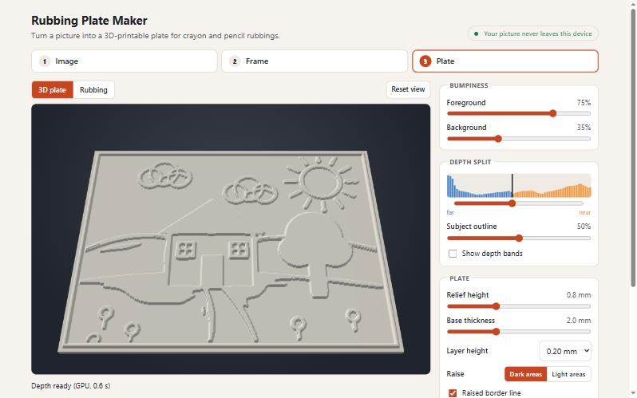
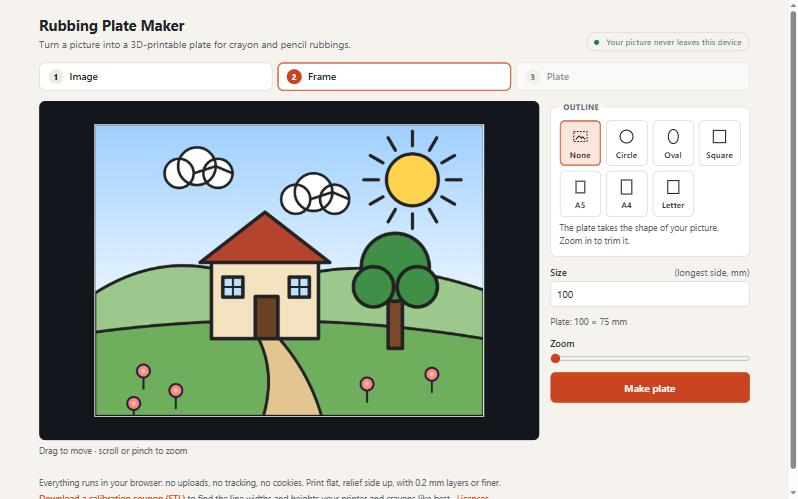
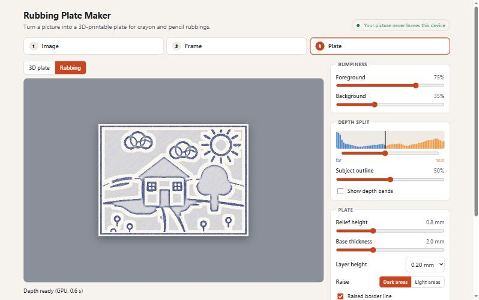

# Rubbing Plate Maker

A web page that turns a picture into a 3D-printable plate for crayon and pencil rubbings.
It runs entirely in the browser; pictures are not uploaded anywhere.

**Use it:** <https://stb1cluny.github.io/rubbings/>



## What a rubbing plate is

A rubbing plate is a flat plate with a raised pattern. Lay a sheet of paper over it, rub the
side of a crayon or pencil across the paper, and the raised parts appear on the paper as
darker marks.

Only crisp raised features transfer. A smooth slope leaves nothing, so a plate made by simply
turning a photo's brightness or depth into height rubs as a mostly blank sheet. This tool
builds the plate from the picture's lines and shapes instead.

## What it does

- Loads a picture from a file, drag and drop, the clipboard, or a link.
- Lets you keep the picture's own shape or crop it to a circle, oval, square, A5, A4 or
  Letter outline.
- Estimates depth in the picture to tell foreground from background, and raises the lines and
  dark shapes in each, with separate control over how much detail each one gets.
- Shows the plate in 3D and as a simulated rubbing.
- Exports a binary STL in millimetres: a closed solid with a base and side walls, ready for a
  slicer.
- Exports a lightmap PNG: the plate's heights as a greyscale image (white is raised), for use
  as a height map in other tools.

## How to use it

### 1. Image

Choose a file, drop one on the page, or paste one with Ctrl+V. Pictures with clear shapes and
strong outlines work best.

Loading from a link only works when the picture's site allows other pages to read it
(Wikimedia Commons and Unsplash do; most sites do not). If a link is refused, open the
picture, copy it, and paste it into the page.

### 2. Frame



Pick an outline and set the size.

| Outline | Plate |
|---|---|
| None (default) | Takes the picture's own proportions; you set the longest side in mm |
| Circle, Oval, Square | You set the diameter or longest side in mm |
| A5, A4, Letter | True paper size, portrait or landscape |

Drag the picture to move it under the outline; scroll, pinch or use the Zoom slider to zoom.
A4 and Letter plates are larger than many printer beds, so check the dimensions shown.

### 3. Plate

**Make plate** builds the preview. Depth is estimated in the background; the first visit
downloads the depth model (about 46 MB), which the browser then caches.

| Control | What it changes |
|---|---|
| Foreground / Background bumpiness | How much of that part's detail is raised, and how tall. 0% leaves it flat |
| Depth split | Where background ends and foreground begins. *Show depth bands* colours the two |
| Subject outline | Strengthens lines that sit on the edge between foreground and background |
| Relief height | Height of the tallest features above the plate surface |
| Base thickness | Thickness of the solid plate under the relief |
| Layer height | Feature heights are rounded to whole layers of this size |
| Raise | Whether dark or light parts of the picture are raised |
| Raised border line | A frame line just inside the plate's edge |

Switch between **3D plate** and **Rubbing** above the preview. The rubbing view is an
approximation of where pigment would land, not a prediction of a particular crayon and paper.



### Download

**Download STL** saves the plate. The line under the button shows the triangle count and file
size before you download. **Download lightmap PNG** saves the height image.

## Printing and rubbing

- Print flat, relief side up, with a 0.4 mm nozzle and 0.2 mm layers or finer. No supports.
- The defaults (0.8 mm relief, 0.5 mm minimum line width, 2 mm base) come from
  tactile-graphics and embossing practice. They have not been measured against real crayon
  rubbings.
- **Download a calibration coupon** in the page footer saves a small test plate with lines
  from 0.4 to 1.2 mm wide at heights from 0.4 to 1.2 mm. Print it and rub it to see what your
  printer, paper and crayons pick up, then set the relief height to match.

## Privacy

- No server, analytics or cookies. Pictures are processed on your device.
- The depth model and its runtime are served from the same site; nothing is fetched from a
  CDN.
- The page's Content-Security-Policy only allows connections to its own origin, and the build
  fails if an unexpected outside address appears in the output.
- The one outside request the page can make is the one you ask for: loading a picture from a
  link. It is sent without cookies or a referrer.

## Browser support

Developed and tested in Chrome on Windows. Depth runs on the GPU where WebGPU is available and
falls back to WebAssembly on the CPU elsewhere, which takes a few seconds longer. Firefox,
Safari and phones have not been tested.

## Run it locally

Requires Node.js 22 or newer.

```
git clone https://github.com/stb1Cluny/rubbings.git
cd rubbings
npm install
npm run dev
```

The first `npm run dev` or `npm run build` downloads the depth model into `public/models/`
(pinned to one revision and checked by SHA-256).

```
npm test         # unit tests
npm run build    # type-check, build to dist/, verify the output
```

`dist/` is a plain static site and can be hosted anywhere. This repository deploys it to
GitHub Pages with `.github/workflows/pages.yml` on every push to `main`.

Two switches help when debugging: `?backend=wasm` forces the CPU path, and `?dtype=<variant>`
loads a different model file from `public/models/…/onnx/`.

## How it works

- `src/depth/` runs [Depth Anything V2 Small](https://github.com/DepthAnything/Depth-Anything-V2)
  through [Transformers.js](https://github.com/huggingface/transformers.js) in a Web Worker.
- `src/relief/` extracts lines and shapes from the picture, splits it into depth bands, and
  composes plate heights from the slider values.
- `src/mesh/` turns the height grid into a closed solid and writes the STL.
- `src/ui/` holds the crop widget, the [three.js](https://threejs.org/) preview and the
  calibration coupon.

The preview, the STL and the lightmap PNG are all produced from the same height array.

## Licence

MIT; see [LICENSE](LICENSE). The bundled model and libraries keep their own licences
(Apache-2.0 and MIT), listed in [public/licenses](public/licenses/index.html).
